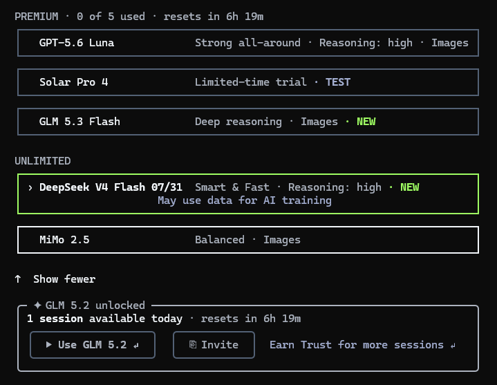

# free-ai-api

[English](README.en.md) | [简体中文](README.md)

A collection of platforms offering free access to AI model APIs.

> Verified on 2026-10-15. Each entry below was checked against public sources on that date. Free-tier policies change often — always confirm on the platform's official site.

## Agent Router

- link: [agentrouter.org](https://agentrouter.org/register?aff=ZJ9a)

An LLM API gateway built on New API; works with Claude Code, Codex, Roo Code, and Qwen Code. Backup domain: [ps.air-outer.com](https://ps.air-outer.com).

- Sign up with GitHub / Linux DO OAuth, no email verification required
- **Top-ups not supported**; quota is earned by:
  - Daily check-in on login: **$25** (log out & back in to activate)
  - Referrals: **$50** each for the inviter and the invitee
  - Occasional redemption-code draws for email-bound accounts; official giveaways

Available models (pay-as-you-go):

- `claude-opus-5` / `claude-opus-4-8` / `claude-opus-4-7`
- `gpt-5.6-sol` / `gpt-5.5`
- `kimi-k2.6`
- `deepseek-v4-flash`
- `glm-5.3`

> Note: the full model list requires logging in to the console. Public data as of 2026-10-15 only confirms `claude-opus-5`, `claude-opus-4-8`, `deepseek-v4-flash` and `gpt-6-astra`; treat the console list as authoritative for the rest.

## B-AI

- link: [chat.b.ai](https://chat.b.ai/chat?invite_code=BL9UBT)
- Invite code: `BL9UBT`

Sign in with Google or a Web3 wallet; no credit card required to get started.

Free usage:

- Registering via the invite link/code grants **300,000 Credits** as a signup bonus (valid for 30 days; unused balance expires) — could not be verified from official channels as of 2026-10-15; confirm after logging in
- Referral rebate: earn **1% Coin** when an invited friend tops up or subscribes (invite relationship valid for 2 years); Coin can be redeemed for Credits (1 Coin = 1,000,000 Credits, redeemed Credits valid for 30 days)
- Currently free models (limited-time promotions):

  - `hy3` (free on both Chat and API)
  - `mimo-v2.5` (API free; Chat free since 2026-08-25)
  - `qwen3.8-flash` (API free; free on Chat once launched)

> Note: `glm-5.3-flash` switched to 10%-of-standard pricing on 2026-09-12 and is no longer free; `deepseek-v4-flash` and `deepseek-v4-flash-vision-exp` left the free tier on 2026-09-03 and moved to discounted pricing (reported as 10% in September coverage).

Billing: prepaid Credits; supports bank cards, WeChat Pay, Alipay, UnionPay and on-chain top-ups.

## FreeBuf

- link: [freebuff.com](https://freebuff.com/?ref=ref-3eb0adde-9983-48f6-9bf3-de3c271c62de)

An ad-sponsored, **100% free** ($0/year) AI coding agent platform — no API key, no credit card. Ships Desktop, CLI, Web, Cloud and Chat; a substitute for paid tools like Codex, Cursor, Claude Code and Devin. Open source: [CodebuffAI/freebuff](https://github.com/CodebuffAI/freebuff).

Free models (full mode, official picker, verified 2026-10-15):

- `mimo-2.6-flash` / `mimo-2.6-pro`
- `gpt-6-luna` (full access, free)
- `glm-5.3-flash`
- `deepseek-v4.1-flash`
- `solar-mini-4` / `solar-pro-4`

> Note: `deepseek-v4-pro` has been retired (official: replaced by GLM 5.3 Flash); `minimax-m3`, `mimo-v2.5` and `glm-5.2` are no longer on the free list; `gemini-3.1-flash-lite` is only used for background tasks like file search. Some models are paywalled (Gemini 3.8 Flash, Muse Spark 1.3) and some are free in the US only (Gemini 4 Argon, GPT-6.1 Sol, 1 session/day).

Restricted mode (some countries or when using a VPN): `mimo-v2.5` only, 3 one-hour sessions/day, up to 7 via Earn interactions. (Not verified as of 2026-10-15; go by what the client shows.)

## WorkBuddy AI

- link: [WorkBuddy AI](https://workbuddy.ai/invite?code=5RQ4528P)

Tencent's all-scenario AI office workbench (an Agent product, not a free API platform). Give it tasks in natural language and it plans and executes multi-step work: documents, spreadsheets, PPTs, data analysis, deep research — and can operate local files in batch once authorized.

Free trial: the international Free plan includes 100 credits/month, 250 signup credits (valid 14 days), a 7-day Pro trial and 30 credits/day for daily activity; the domestic free tier remains (2,000 signup points, daily claims). Step 5 Preview joined on 2026-10-12, free for a limited time until Oct 25.

Built-in models (third-party records since 2026-09): Tencent Hunyuan (HY series), Kimi K3, DeepSeek V4.1 Flash.

> Note: there is no free developer API; GPT-class models are wired up by users themselves in advanced settings via third-party relays — they don't ship with the product. Confirm models and quotas in the client.

## Freemodel

- link: [freemodel.dev](https://freemodel.dev/invite/FRE-e71f7daa)

A platform for free frontier AI model access — "Frontier AI, free for everyone".

- Free forever, no credit card: the official site says signup credits land instantly and verification (phone/Telegram) earns more, but publishes no amounts — go by the post-login page (no amounts published as of the 2026-10-15 check; a third-party list updated 2026-10-14 cites $10 Free Credit, unverified officially)
- 1 month of Pro for verified new users (not found in public sources as of 2026-10-15; confirm after logging in), unlocking high-rate frontier model access
- Referral rewards: **$10 credit** each for you and a verified friend (not found in public sources as of 2026-10-15; confirm after logging in)
- No time-window quota on the free tier; usage deducts from your credit balance until it's gone

Available models (probed 2026-10-15 on the official no-auth endpoint `/v1/models`; OpenAI- and Anthropic-compatible routing):

- `gpt-6-luna` / `gpt-6-sol` / `gpt-6-astra`

> Note: the previous gpt-5.x series and the entire Claude lineup were removed after mid-to-late September 2026 and are not on the current list.

## TokenLB

- link: [tokenlb.net](https://tokenlb.net/sign-up?aff=iqik)

- Free to start, no credit card required; a third-party video (2026-09-25) claims a **$50** signup credit (not verified on the official page)
- New users get a starter quota on signup

Supported models:

- `claude-opus-4-8` (added per third-party video, 2026-09-25)
- `claude-opus-4-7`
- `claude-opus-4-6`
- `claude-sonnet-4-6`
- `gpt-5.5`
- `gpt-5.4`
- `gpt-5.4-mini`
- `gemini-3-flash-preview`

> Note: direct fetches of the homepage returned HTTP 500 on 2026-10-15 (possibly a fetch-route issue); no third-party reports of downtime. Go by the live official page.

## GoRouter

> ⚠️ As of 2026-10-15 the official site fails to load (HTTP 502); third-party technical reports since 2026-09 show its upstream unreachable and its model list empty — likely down or out of channels. **Not recommended for now**; the original entry is kept below for reference.

- link: [gorouter.app](https://gorouter.app/sign-up?aff=k5Fm)

Sign up with GitHub (no email verification required).

- Free to start, no credit card required
- New users get a starter quota on signup
- Daily check-in for a random quota
- Referral rewards: both inviter and invitee earn quota via the link

Currently available models in the default group:

- `claude-opus-5` / `claude-opus-5-thinking`
- `claude-opus-4-8` / `claude-opus-4-8-thinking`
